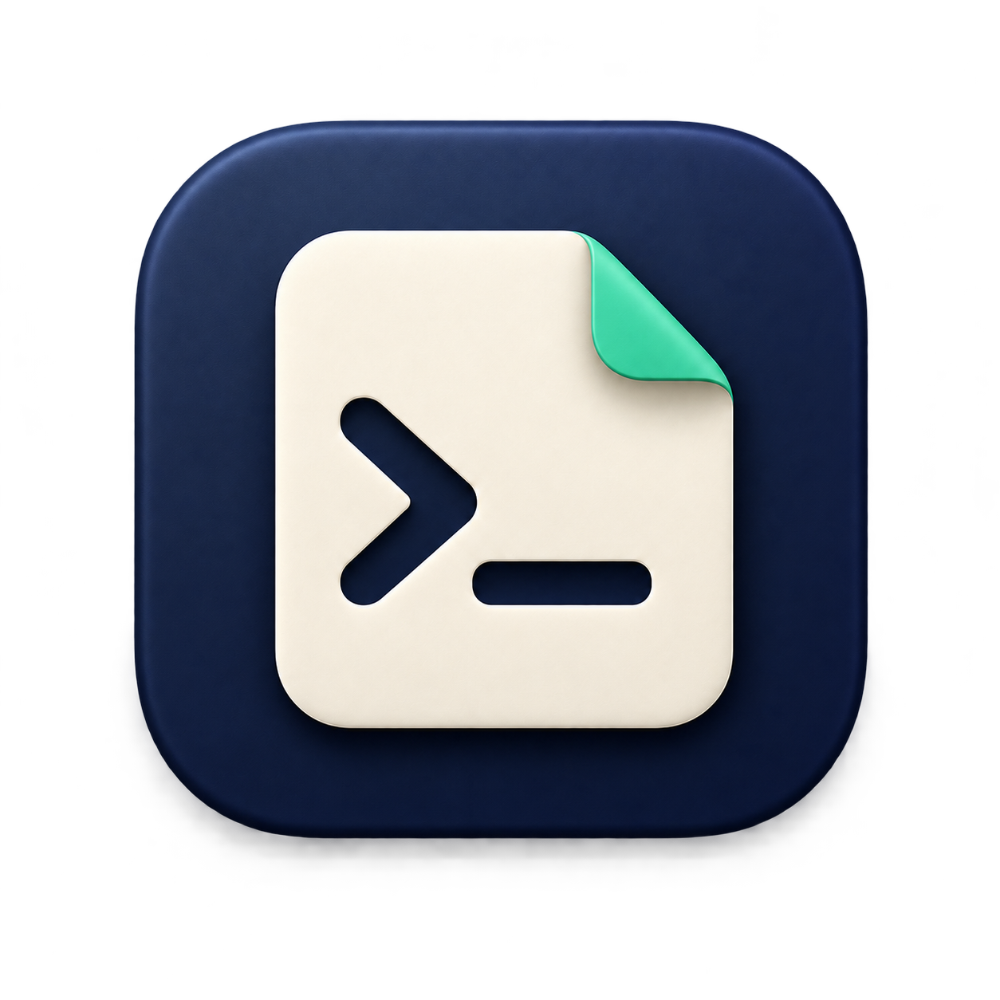
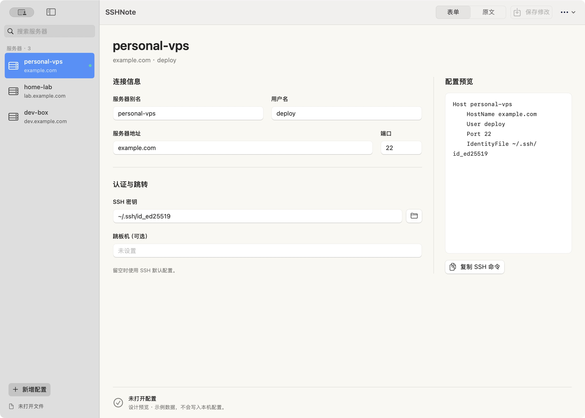

<p align="center">
  
</p>

# SSHNote

一个轻量的 macOS SSH 配置编辑器。用中文表单管理服务器别名，也能随时切换到原文。

[](https://github.com/ZestBox-18/ssh-note/actions/workflows/check.yml)
[](LICENSE)



*截图来自 macOS 15；macOS 26 及更新系统的原生组件外观由系统决定。*

## 能做什么

- **直接编辑 SSH 配置**：启动读取 `~/.ssh/config`，也支持打开其他配置文件。
- **中文表单**：管理别名、服务器地址、用户名、端口、密钥路径和跳板机，实时查看配置预览。
- **保留原文**：修改表单字段时保留其他指令与注释；复杂规则可在原文模式编辑。
- **显式保存**：点击保存或按 `⌘S` 后写入，保存前检查外部修改、备份原文件并保留权限。
- **备份与迁移**：导出配置到任意目录，包括 iCloud Drive；恢复时先载入草稿，确认后保存。
- **原生 macOS 界面**：系统侧栏、工具栏、分段选择器和输入框，支持系统明暗外观。

SSHNote 不提供终端或 SFTP，也不会连接服务器、执行配置中的命令或上传配置。无需注册账户，没有第三方运行时依赖。

## 安装与构建

目前为开发预览，提供源码构建；尚无经过 Developer ID 签名和 Apple 公证的正式安装包。

**运行要求：** macOS 15 或更新版本。构建脚本默认生成当前机器架构的应用，不是 Universal 包。

**构建要求：** Swift 6.0+、Xcode 或 Apple Command Line Tools。要启用 macOS 26 引入的 Liquid Glass 系统外观，请使用 **Xcode 26+ / macOS SDK 26+** 构建。

```sh
git clone https://github.com/ZestBox-18/ssh-note.git
cd ssh-note
swift run CoreChecks
./scripts/build-app.sh
open dist/SSHNote.app
```

构建后可将 `dist/SSHNote.app` 拖入“应用程序”。脚本使用 ad-hoc 签名，适合自行构建使用，不等同于 Apple 公证。

### 系统外观兼容

| 运行环境 | 外观 |
| --- | --- |
| macOS 15 | 系统原生侧栏、工具栏与兼容材质 |
| macOS 26+，使用 SDK 26+ 构建 | 原生导航和工具栏采用系统 Liquid Glass 外观 |
| macOS 26+，使用旧 SDK 构建 | 保持旧版系统外观，不会仅因升级系统就获得 Liquid Glass |

透明度、明暗模式及辅助功能设置由系统控制。玻璃材质用于导航和操作区域，编辑正文保持清晰易读。CI 分别在 macOS 15 与 macOS 26 构建；构建检查不等于所有系统上的视觉验收。

## 使用

1. 打开 SSHNote。已有的 `~/.ssh/config` 会自动载入；其他文件可从工具栏的“文件与备份”菜单打开。
2. 选择服务器并填写表单，或点击“新增配置”。`Host *`、`Match` 等复杂规则请使用原文模式。
3. 检查配置预览，点击“保存修改”或按 `⌘S`。
4. 在终端运行 `ssh 你的别名`。别名由 SSH 从配置中读取，**不需要注入环境变量，也不需要重启终端**。

没有配置文件时，可以新增配置，再通过“导出备份”保存为 `~/.ssh/config`（先创建 `~/.ssh` 目录），随后打开该文件继续编辑。

### 备份与换机器

自动备份保存在当前配置文件旁的 `.sshnote-backups/`，每次保存保留一份修改前的完整原文。

选择“导出备份”可将配置文本存入 iCloud Drive 等目录。在另一台 Mac 上准备好配置文件，选择“恢复备份”，检查内容后保存。恢复会替换当前文件的完整内容，不会合并两份配置；尚未打开文件时，请先打开目标文件，或将恢复的草稿导出到所需位置。

备份不包含私钥和 `Include` 引用的其他文件。换机器后需要另行准备密钥，并核对用户名、路径与引用文件。iCloud 上传和下载由系统负责，SSHNote 不提供自动双向同步。

### 配置支持范围

表单支持单个普通 Host 别名及常用字段。通配符、多别名、重复字段、带引号的复杂值、块内 `Include` 等情况使用原文编辑。`Include` 引用的文件需分别打开。

SSHNote 不对整份文件做 SSH 语义验证，也不运行 `ssh -G`，以免执行 `Match exec` 等配置中的命令。原文模式应按 OpenSSH 的语法编辑。配置和备份可能包含敏感信息，请勿提交真实配置或私钥到仓库。

## 参与开发

欢迎提交 [Issue](https://github.com/ZestBox-18/ssh-note/issues) 或 Pull Request。报告问题时请提供 macOS 版本、构建工具版本、复现步骤，以及脱敏后的最小配置示例。

- `Sources/SSHNote`：SwiftUI 界面与编辑状态。
- `Sources/SSHNoteCore`：配置解析、局部修改、冲突检查和文件备份。
- `Tests/SSHNoteCoreTests`：无第三方依赖的核心行为校验，运行 `swift run CoreChecks`。
- `scripts`：应用和图标构建脚本。
- [设计与发布决策](ai-docs/decisions/001-scope-and-release.md)、[系统外观适配](ai-docs/decisions/002-native-appearance.md)、[验证记录](ai-docs/validation.md)。

提交前请运行核心校验和应用构建。界面变更请同时检查表单/原文切换、未保存输入保护、明暗外观，以及支持的系统版本。可用以下命令打开虚构数据预览，便于截图和调试：

```sh
dist/SSHNote.app/Contents/MacOS/SSHNote --preview
# 仅为当前预览进程启用深色，不修改系统设置
dist/SSHNote.app/Contents/MacOS/SSHNote --preview --dark
```

## 许可

[MIT License](LICENSE)。
